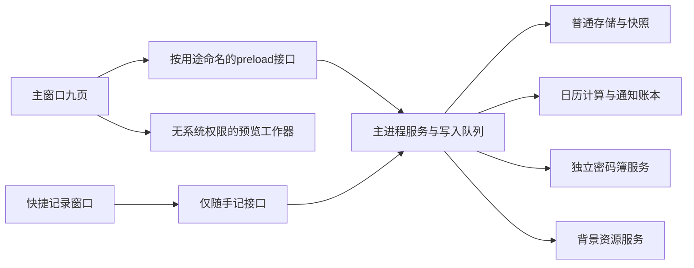

# Work Station · Step 2 架构与选型

核查日期2026-10-23。此文是静态设计及只读资料核查，未克隆、安装、构建或运行候选。行为见[行为决策](step2-behavior-decisions.md)，存储见[数据设计](step2-data-design.md)，入口及验证见[交接](step2-validation-handoff.md)。

续审日期2026-10-25：补查固定版本文件、模板更新页面、Vite/TypeScript安全页面与Windows剪贴板接口。10月23日记录保留其核查日期，后文新增证据单列，不将旧快照说成最新发布结论。

## AR-01 模块与进程

选择精简Electron骨架、TypeScript、Vite、本地HTML/CSS与原生表单控件；首版编辑器采用textarea＋工具栏＋独立预览，不另引重量编辑器或UI框架。复杂布局通过模块化视图控制器管理；若中文输入/大文档体验未达标，T06再以明确缺口评估CodeMirror，不预先扩大依赖。

主进程管理文件、调度、窗口、托盘、通知、快捷键、加密和导入事务。preload只桥接白名单业务函数，剥离Electron event，不提供通用send/invoke、不暴露Node或文件路径操作。渲染进程处理输入、展示及视图状态，无磁盘能力；预览Worker仅接收当前笔记文本，不接触密码簿，超时可终止。

Worker只进行Markdown/公式字符串运算，DOMPurify在具有DOM的受限渲染进程中净化返回结果，不能假设普通Worker有document。图像转码使用另一受限Worker，仅处理主进程检查过的字节；最后由主进程复核并写盘。Worker异常或超时可单独终止，不阻断普通编辑和存储。

九页与服务：今日首页→普通查询/课表/调度派生视图；LaTeX笔记→notes/preview；DDL提醒→tasks/rules/reminders；随手记→memos；密码簿→vault；课表→semesters/courses；外观→appearance/images；数据管理→backup/import/snapshots/clear；设置→preferences/shortcuts/lifecycle。标签跨前三种普通内容，分类仅DDL。首页不保存第二份任务/课程；全局搜索只索引普通文本、标题、标签与DDL分类，索引为内存派生，订阅revision变化重建受影响项。密码簿即使解锁也不能进入普通搜索路径。

## AR-02 IPC契约与权限

| 接口族（不是任意通道） | 输入 | 输出／错误 |
| --- | --- | --- |
| ordinary.list/get/search | 类型枚举、ID、分页、有限查询词 | 脱离内部对象的DTO、revision；不存在NOT_FOUND |
| notes/memos.save/delete | 白名单字段、ID、baseRevision、mutationId | 提交revision/保存时间；CONFLICT/VALIDATION/IO_FAILED |
| tasks.setStatus；rules.create/revise/stop；tasks.delete | ID、明确动作/范围、基线revision | 已提交DTO；不允许客户端直接设账本状态 |
| schedule.preview；reminders.list/locate | 已校验规则或定位ID、分页 | 只读计划卡片/提醒记录，不写Task |
| course.save/delete；semester.save | 明确字段、revision、冲突确认token | 冲突明细或提交结果；token绑定待保存内容和revision |
| settings.update；quick.open | 白名单键、值；无任意URL | 生效值、快捷键注册结果；注册失败保留原键 |
| transfer.choose/preview/resolve/commit/cancel | 类型、主进程发放fileHandle/planId、逐条选择 | 预览差异、数量、进度；文件路径不来自网页输入 |
| vault.unlock/lock/list/save/copy/export/restore/changePassword | 密码或条目字段、短期sessionToken、operationId | 最小必要字段；LOCKED/AUTH_FAILED；无堆栈或密文细节 |
| clear.prepare/confirm | 主进程生成一次性challenge，二次确认 | 清除进度/完成/可重试项；不能传删除路径 |

统一返回{ok:true,data,revision}或{ok:false,code,userMessage,retryable}；对事件订阅返回可取消订阅函数，不把event对象交给渲染器。校验调用窗口ID、主框架、精确app源、接口能力、数据类型/长度/枚举/嵌套深度/危险键；未知字段拒绝。Zod用于结构，业务关系与权限仍单独验证；拒绝__proto__/constructor/prototype作为输入结构键。文件对话框返回的句柄短期有效、绑定窗口与用途。

主窗口和快捷窗口共享单写队列及版本广播；快捷窗口只能创建/编辑自己打开的随手记，不能调用vault、导入或清除。相同记录并发修改时返回冲突，不采用最后写入覆盖。事件广播只给实体ID/revision，不广播正文或密码。全局快捷键建议Ctrl+Alt+N可改，注册失败提示更换；Ctrl+K仅应用内搜索。

## AR-03 渲染、安全与离线

所有窗口显式nodeIntegration=false、contextIsolation=true、sandbox=true、webSecurity=true、devTools=false（生产）；禁webview、任意窗口创建、外部will-navigate、拖拽导航；session权限请求/检查默认拒绝（摄像头、麦克风、位置、USB/HID等均无业务需求）。preload打包为沙箱兼容单文件。自定义app://本地资源协议只映射打包清单及由主进程审核的图片hash，拒绝路径穿越，不回退任意file://读取，启用正确secure/standard/corsEnabled属性。

生产CSP基线：default-src 'none'; script-src 'self'; worker-src 'self'; connect-src 'none'; img-src 'self'; font-src 'self'; style-src 'self'; style-src-attr 'unsafe-inline'; object-src 'none'; frame-src 'none'; base-uri 'none'; form-action 'none'。style属性例外仅为KaTeX生成排版与主题值，净化只准许有限排版属性/数值，禁url()/外部引用；如不能在此边界下保留公式效果，V-RENDER必须先解决，不能放宽script策略。无eval或生产远程调试参数/菜单/快捷入口。

Markdown支持标题1—6、段落、软/硬换行、加粗斜体、删除线、引用、无序/有序列表、行内代码、围栏代码、分隔线、表格、普通链接；html=false、linkify=false、typographer=false。图片语法只显示替代文字“外部图片未加载”，不读取远程或任意本机图片；本版笔记没有附件管理，不把背景包当附件备份。

四种公式分隔符通过待实现及测试的小型token规则接入markdown-it；代码块/行内代码/转义美元符不识别公式；不跨块吞掉正文，空/未闭合分隔符保留文本。KaTeX trust=false、maxExpand=1000、maxSize=20，单公式≤20KiB；隔离每次宏表，不从用户数据合并原型属性。Markdown及公式最终HTML统一DOMPurify净化，再插入专用预览容器；只允许必要HTML/MathML/静态SVG路径，禁SMIL动画、foreignObject、事件属性、任意URL样式，不启用IN_PLACE、自定义元素或用户hook。错误消息用textContent展示，不能直接插入原始错误HTML。

普通Markdown链接不自动打开；用户点击先显示目标域名和“用浏览器打开”，主进程仅允许规范化http/https并再次确认真实用户动作；拒绝javascript/file/data等。公式外链及includegraphics禁用。浏览器主动访问不算默认应用联网，但验证时单独记录。

所有JS、CSS、KaTeX字体、图标与默认背景随包，中文优先Windows本地字体，无远程字体。主进程无HTTP业务客户端，无updater/telemetry/crashReporter.start；会话请求拦截拒绝http/https/ws/wss，开发服务器只在开发模式、环回地址生效。此拦截不能覆盖Node出站，需审查主进程依赖并监测整个进程树。禁止日志记录正文、搜索词、密码、备份内容；日志仅错误码、耗时桶、随机操作ID。

验证分两套：断网冷启动后逐页完成编辑/公式/到期/备份恢复；联网状态首次启动、常规操作、托盘待机、恢复分别监测进程树DNS/TCP/HTTP，预期无应用主动网络请求。下载开发依赖与发布操作属于开发阶段，不混入产品离线结论。

## AR-04 候选证据、版本与适配

以下核查均为2026-10-23。版本指拟冻结候选，不宣称已装好或全依赖安全。正式锁文件在Step 3建立，届时重查漏洞和版本兼容。仓库元数据表明原四候选均未归档；最近push分别为模板09-01、markdown-it 10-23、KaTeX 10-22、DOMPurify 10-23，仅证明有活动，不等于质量保证。

| 组件／结论 | 用途、来源与拟采用版本 | 许可与保留 | 兼容性、联网/权限、改造及待测 |
| --- | --- | --- | --- |
| electron-vite-react：放弃直接改造 | [仓库](https://github.com/electron-vite/electron-vite-react)、[说明](https://github.com/electron-vite/electron-vite-react/blob/main/README.md)；package标2.3.0 | MIT，若复制实质代码需保留版权/许可 | 模板自带更新和宽IPC、示例子窗危险权限；清除成本大于精简组合；仅作审查参考，不声称已发现默认自动检查调用 |
| Electron：采用 | SCOPE/SEC/DDL/QUICK；[仓库](https://github.com/electron/electron)、[文档](https://www.electronjs.org/docs/latest/)、[v45.0.0](https://github.com/electron/electron/releases/tag/v45.0.0) | MIT＋随包Chromium/Node第三方许可，保留LICENSES及声明 | [README平台支持](https://github.com/electron/electron#platform-support)写Windows10及以上x64；须两系统实测；默认能力不等于业务授权，AR-03收紧；不调用更新/崩溃上传API |
| markdown-it：采用 | NOTE；[仓库/API](https://github.com/markdown-it/markdown-it)、[文档](https://markdown-it.github.io/markdown-it/)；15.0.3，package blob c5696de8683665a3cefb0911a8d1173f929c45b5 | MIT版权/许可随源码和分发保留 | JS解析器，Electron浏览器构建待测；自身解析不下载资源，最终输出仍须净化/禁图片；不启用任意第三方插件 |
| KaTeX：采用 | NOTE；[仓库](https://github.com/KaTeX/KaTeX)、[安全文档](https://katex.org/docs/security)、[v0.19.0](https://github.com/KaTeX/KaTeX/releases/tag/v0.19.0) | MIT，保留字体及发行包附带许可证 | 浏览器渲染与本地字体打包；禁trust外链；净化后矩阵/分段及CSP兼容待测 |
| DOMPurify：采用 | NOTE/SEC；[仓库](https://github.com/cure53/DOMPurify)、[配置文档](https://github.com/cure53/DOMPurify#can-i-configure-dompurify)、[3.4.17](https://github.com/cure53/DOMPurify/releases/tag/3.4.17) | MPL-2.0 OR Apache-2.0，选Apache-2.0分支，保留LICENSE/版权/存在的NOTICE，改动标注 | 使用Electron DOM而非另装jsdom；无主动网络业务；禁止可执行SVG等；真实浏览器恶意样本测试必须通过 |
| Temporal polyfill：采用 | DDL/COURSE；[仓库与用法](https://github.com/js-temporal/temporal-polyfill)、[API](https://tc39.es/proposal-temporal/docs/)；@js-temporal/polyfill 0.5.1，package blob a81b884f9ac5c785315794d76c4814dc051fa39c | ISC版权/许可保留 | 主进程JS＋Intl时区，未归档，09-22 push；不下载时区库，目标Electron的ICU解析需DT11/12实测；适配器隔离库API，失败再评估内置Temporal |
| Zod：采用 | IPC/导入校验；[仓库](https://github.com/colinhacks/zod)、[文档](https://zod.dev/)、[v4.6.7](https://github.com/colinhacks/zod/releases/tag/v4.6.7) | MIT版权/许可保留 | 主进程校验不依赖网络；不把文档MCP服务接入应用；未归档，10-19 push；使用普通校验路径，避开运行时编译/CSP冲突，超大输入限制另做 |
| electron-builder：采用 | REL；[仓库](https://github.com/electron-userland/electron-builder)、[Windows文档](https://www.electron.build/win/)、[26.18.0](https://github.com/electron-userland/electron-builder/releases/tag/electron-builder%4026.18.0) | MIT及NSIS/工具附带许可需清单核对 | 未归档10-23 push；构建期会下载工具，用户运行不需要；只选NSIS x64＋portable x64，publish=never，不引electron-updater，无自动签名配置；双包需V-PACK |
| Vite：采用开发构建 | [仓库](https://github.com/vitejs/vite)、[文档](https://vite.dev/guide/)、[v8.3.5](https://github.com/vitejs/vite/releases/tag/v8.3.5) | MIT及传递工具声明 | 官方package engines Node ^20.19或≥22.12；开发服务仅环回、不打包服务端；禁代理及外部资源，生产构建检查；版本当日发布信息可查，非已验证 |
| TypeScript：采用开发编译 | [仓库](https://github.com/microsoft/TypeScript)、[文档](https://www.typescriptlang.org/docs/)、[v6.0.3](https://github.com/microsoft/TypeScript/releases/tag/v6.0.3) | Apache-2.0，保留声明及修改说明 | 10月25日按固定tag核对package版本6.0.3、Node≥14.17；替换上次仅按release标签推定的7.0.2，原因见E-RESUME；不进入产品运行时 |
| 内置textarea、node:test/crypto：采用 | NOTE/REL/VAULT；[测试文档](https://nodejs.org/api/test.html)、[crypto](https://nodejs.org/api/crypto.html) | 随Electron/Node发行许可 | 不另装编辑器/测试框架/加密原生扩展；使用所选Electron内置Node版本验证测试入口，crypto主进程异步运行，无网络 |

开发Node版本需满足Vite/TypeScript发布包engines，T03记录确切补丁版本；Electron内置Node与开发Node是不同运行时，不能假设相同。Node测试先编译TS，再运行纯领域模块；Windows UI用真实系统操作，不以node:test代替。

### 模板源码核查（E-TEMPLATE）

GitHub连接只读取得：[main/index.ts](https://github.com/electron-vite/electron-vite-react/blob/main/electron/main/index.ts) blob a8208836c1e62abd54f354aa596fcdf2392e5495；[preload/index.ts](https://github.com/electron-vite/electron-vite-react/blob/main/electron/preload/index.ts) blob 3ddef8b507566b211f6aadb0c8bae56d578743a6；[update.ts](https://github.com/electron-vite/electron-vite-react/blob/main/electron/main/update.ts) blob e95361715628599c7f7f3a7fd6ad4c2681aece2e；[package.json](https://github.com/electron-vite/electron-vite-react/blob/main/package.json) blob 7ea03cff5295893706d066c4a08ddc37afebf44a。blob用于核查文件身份，不冒充整仓库commit。

主窗口创建会调用update注册更新IPC；check-update才调用checkForUpdates，autoDownload=false不等于移除联网功能。示例open-win明确nodeIntegration=true/contextIsolation=false；preload暴露任意on/send/invoke且把event交给页面；https新窗口直接shell.openExternal。主窗口的危险选项是注释，不能错称主窗口已开启Node。Vite配置仍列renderer兼容插件但调用注释；package有electron-updater依赖。

改造模板需要删更新依赖/模块/页面入口、重做preload和示例窗口、重查外链/开发配置/测试示例/打包设置；精简骨架需要自己写启动与构建配置，但权限面更小。本产品不需要模板展示功能，选择后者。两种均须同样的V-BOOT/SEC/OFFLINE验证，不能以骨架小免审。

### E-SECURITY 安全公告核查

- [markdown-it GHSA-gfr2-rv44-r23c](https://github.com/markdown-it/markdown-it/security/advisories/GHSA-gfr2-rv44-r23c)：15.0.0—15.0.2受影响，15.0.3修复；关闭html/linkify/typographer之外，仍需大输入超时隔离。公告列表还含其他复杂度问题，锁文件建立时核全依赖。
- [DOMPurify XHTML公告](https://github.com/cure53/DOMPurify/security/advisories/GHSA-c6gr-qvv4-5v3f)与[IN_PLACE公告](https://github.com/cure53/DOMPurify/security/advisories/GHSA-mrv2-3pqr-j5jr)：≤3.4.16受影响、3.4.17修复；本设计同时禁相关模式。不能将“配置不启用”代替更新。
- [KaTeX原型污染相关公告](https://github.com/KaTeX/KaTeX/security/advisories/GHSA-238p-pmpm-9mq7)：<0.18.2的相关版本受影响，0.18.2修复；拟0.19.0仍做非法原型输入测试。
- [Electron证书公告](https://github.com/electron/electron/security/advisories/GHSA-jr5w-w6x2-84p9)：45线从beta.6修复，拟45.0.0已越过此修复点；这只说明该公告，不能断言全部Chromium/Node漏洞清零。[公告列表](https://github.com/electron/electron/security/advisories)另有权限/窗口问题，禁webview/新窗口并在T03复核所选版本范围。
- [builder公告列表](https://github.com/electron-userland/electron-builder/security/advisories)存在重定向凭证泄露、旧NSIS与updater问题；不使用updater/自动发布，构建凭证不进运行包。10月25日已补查26.18.0固定tag内builder-util-runtime为9.7.0，达到该重定向公告修复下限；实际锁文件及整棵传递依赖仍待V-DEPS。
- [Zod](https://github.com/colinhacks/zod/security/advisories)与[Temporal](https://github.com/js-temporal/temporal-polyfill/security/advisories)公开页面已查看；空列表或页面有限不等于无漏洞。Vite与TypeScript补查结果见E-RESUME；实际安装包、工具链及全部传递依赖仍需V-DEPS，检查完成后再首次提交。

### E-RESUME 续审证据（2026-10-25）

| 核查 | 证据与结论 | 仍需验证 |
| --- | --- | --- |
| 模板默认更新行为 | [更新组件](https://github.com/electron-vite/electron-vite-react/blob/main/src/components/update/index.tsx)，blob 8b8f1ec3f7b7b17b19da0b88326647a13055e4b3，按钮点击触发check-update；所读useEffect只注册监听，未见启动时自动检查调用 | 这是所读路径的静态结论，不能外推整仓库无默认网络；本产品直接移除全部更新能力 |
| builder目标与权限 | 固定tag的[Windows选项源码](https://github.com/electron-userland/electron-builder/blob/electron-builder%4026.18.0/packages/app-builder-lib/src/options/winOptions.ts)列nsis/portable及默认asInvoker，blob 54f8d0021421dbe875b1113eb65b104d1cf3763f；选择用户级安装，不要求管理员 | 安装/卸载、托盘通知、元数据和双包单实例实测；无签名时保留资源编辑，显式关闭signExecutable，不粗暴关闭图标/版本元数据 |
| builder重定向修复 | [公告](https://github.com/electron-userland/electron-builder/security/advisories/GHSA-p2f4-r6v6-j797)修复下限9.7.0；固定tag的[运行库package](https://github.com/electron-userland/electron-builder/blob/electron-builder%4026.18.0/packages/builder-util-runtime/package.json)为9.7.0，blob d751c07b07f7cd2dd152c1daebd9538b50692084 | 锁文件解析结果必须同样满足，源码版本不代替实际安装包 |
| Vite固定版本与安全 | [8.3.5 package](https://github.com/vitejs/vite/blob/v8.3.5/packages/vite/package.json)，blob bfd514266de3906835dae283cdde89bf1fe2c047；[Wasm路径公告](https://github.com/vitejs/vite/security/advisories/GHSA-vfpm-58rq-9qcg)在8.3.3修复，[Windows路径公告](https://github.com/vitejs/vite/security/advisories/GHSA-fx2h-pf6j-xcff)在8.0.16修复；[10月21日公告](https://github.com/vitejs/vite/security/advisories/GHSA-8g5g-mxqh-grgj)针对6.4.4 | 8.3.5避开所列范围，不能据此称全部公告已清；开发服务只绑定环回、不载入个人数据；运行包不含开发服务器 |
| TypeScript版本纠正 | 上次release元数据给出7.0.2，但续读该tag的package显示6.0.0，证据不一致；不据此断言7.0.2可安装。改选[6.0.3固定文件](https://github.com/microsoft/TypeScript/blob/v6.0.3/package.json)，blob 703fd46cf275d5f65a64363754857f67ee70b696，与[对应发布页](https://github.com/microsoft/TypeScript/releases/tag/v6.0.3)一致 | npm实际发布包/完整性/工具链需T03复核；[安全页](https://github.com/microsoft/TypeScript/security/advisories)当前无已发布公告，仍需查实际依赖 |

Vite与TypeScript仓库10月23日读取均未归档、当天有push；此为维护活动证据。额外原生能力仅限下述剪贴板缺口；不扩展搜索其他编辑器/框架。

### AR-CLIP 剪贴板替换保护的实现边界

[Electron剪贴板公开接口](https://www.electronjs.org/docs/latest/api/clipboard)没有已核实的“比较版本并原子清除”方法，仅先read再clear有竞态。为满足VAULT-006，规划一个只供主进程使用的最小Windows本地适配模块：复制时写CF_UNICODETEXT并保存系统序列号及复制代次；30秒计时到达后OpenClipboard取得排他访问，在同一持有区间核对序列号、所有者及当前复制代次，只有仍为本次写入时才EmptyClipboard，最后CloseClipboard。其他程序即使复制相同字符串也会改变系统版本，不能误清；新的本应用复制使旧计时器失效。

依据[Windows剪贴板访问约定](https://learn.microsoft.com/en-us/windows/win32/dataxchg/using-the-clipboard)与[序列号API](https://learn.microsoft.com/en-us/windows/win32/api/winuser/nf-winuser-getclipboardsequencenumber)。模块只暴露copySecret/clearIfUnchanged，不暴露任意Win32调用、路径或shell；不授予渲染端原生能力。此为待实现的系统适配，不是自制加密；其源码随项目交付，不引入通用FFI包。

V-CLIP前置验证Windows10/11 x64构建/打包、ABI、复制后替换竞态和剪贴板暂时被占用。30秒时无法取得系统剪贴板则不能强行清除，界面报告“剪贴板正被占用，未能自动清除”，仅在确认序列仍未变化时有限重试；退出前仍尝试条件清除。若本地适配未通过，不得用字符串比较声称已满足VAULT-006；T09复制功能及最终发布受阻，安全骨架可继续。无需在本设计阶段安装编译器或编写该模块。

许可证归档需在T03锁版本后对实际安装包逐个核对：THIRD_PARTY_NOTICES、原许可证文本、字体/图标声明、修改说明随安装与便携包；当前不伪造未安装包的最终声明清单。生产无遥测/默认联网为产品约束，组件组合后的实际行为须V-OFFLINE证明。

## AR-05 决策记录

目标：提供离线Windows工作台。约束：单用户、三类迁移文件隔离、禁止默认网络。方案：精简进程边界＋结构化文件事务＋本地解析组件。依据：Step1基线、E-TEMPLATE源码和官方安全资料。验证方法：交接文档V-BOOT/DEPS/SEC/RENDER/OFFLINE。结果：架构设计完成、运行结论未产生。复用经验候选：权限面审查与网络证据分开，待实际验证再考虑技能化。
