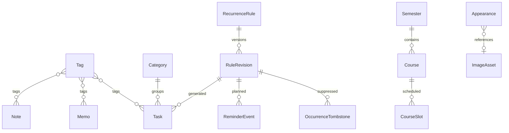

# Work Station · Step 2 数据与恢复设计

2026-10-23。设计定稿，格式参数为首版工程基线；未进行读写故障或加密性能实测。行为依据[行为决策](step2-behavior-decisions.md)，验证见[交接](step2-validation-handoff.md)。

2026-10-25续审补齐：提醒策略与版本、分类删除引用、快照哈希投影、统一提交和图片编码范围。U2/U3仍为用户决策依据，技术补充不冒充新的用户确认。

## D-01 目录与通用字段

安装版/便携版同一Windows用户共享 `%LOCALAPPDATA%\WorkStation`，不依赖exe所在目录；启动显式设置Electron userData/sessionData到管理根目录下。不同Windows用户各自隔离。固定appId，根目录锁与Electron单实例锁共同阻止两包并行写入；第二进程唤醒第一进程后退出，不传任意文件路径。旧版看到高版本数据拒绝打开，不自动降级。

```text
WorkStation/
  owner.json                 固定产品标识与目录格式版本，不接受导入替换
  ordinary/current.json      普通数据、提醒账本、删除标记的一个一致版本
  ordinary/previous.json     上次可恢复普通版本（不算用户快照）
  vault/current.wsvault      整簿密文
  images/<sha256>.webp       管理的背景资源
  snapshots/<id>.json        最多7份普通快照，索引可重建
  transactions/<id>/         journal、old、new；密码簿仅密文
  staging/<id>/              图片暂存、导入准备；无密码簿明文
  runtime/                   Electron缓存、会话、诊断元数据
```

普通结构根字段：kind="work-station-ordinary"、schemaVersion=1、revision非负递增整数、datasetId UUID、savedAt UTC、payload、contentHash（规范化payload的SHA-256，排除revision/保存时间等元数据）。ID用主进程crypto.randomUUID，所有业务实体稳定UUID；导入不能提供路径。创建/修改/完成时间为UTC ISO字符串；业务日历日期为YYYY-MM-DD、时间HH:mm、时区为IANA标识，均严校验，不用时区模糊的Date.parse猜测。每个实体含id、createdAt、updatedAt、entityRevision；实体rev仅并发控制，不作跨文件冲突“较新者覆盖”的依据。

规范化规则：对象键排序、数组按其业务顺序（集合按稳定ID排序）、UTF-8、无额外空白、有限JSON数字、不接受重复键。contentHash覆盖完整payload（包括运行账本），只用于文件完整性；另算snapshotHash覆盖普通业务投影，排除投递账本、扫描心跳/游标更新时间、保存状态及纯审计更新时间。只有业务内容改变才触发每日快照，通知标记写盘不能制造相同业务快照。导出hash覆盖其声明的完整payload。schemaVersion用于业务结构，formatVersion用于外层文件封装，二者不混用。

## D-02 字段表与关系

| 实体 | 关键字段 | 关联与校验 |
| --- | --- | --- |
| Note | title, markdown, tagIds | 标签存在，正文UTF-8 ≤2MiB；基础Markdown清单见架构AR-03 |
| Memo | title, body, tagIds | 独立记录，更新时间排序；快速窗口复用同一接口 |
| Tag | name, color, deletedAt? | 名称去首尾空格；不同ID同名不自动合并；删除从当前可编辑内容解除关联，历史版本引用保留墓碑 |
| Category | name, deletedAt? | 只用于DDL；删除事务把所有现存Task.categoryId置null，历史RuleRevision的原引用指向墓碑，不悬空；以后生成新期解析墓碑为未分类 |
| RecurrenceRule | id, active, currentRevisionId, reminderPolicyId, stoppedAt, resumedAt? | 逻辑规则容器；停止不删除历史，重新开启下界见B-02 |
| RuleRevision | ruleId, effectiveFrom, effectiveUntil, startDate, time, kind(day/week/month), interval, weekdays, anchorWeek, anchorMonth, originalDay, title, notes, categoryId, tagIds | 计划内容不可变，effectiveUntil仅允许关闭一次；周/月锚点显式保留。版本生效区间按B-02旧版含边界、新版严格晚于边界定义 |
| ReminderPolicy | ruleId, leadMinutes, policyRevision | 提前量可改但不更换计划期身份；新Task取该策略快照；已发事件不重发 |
| Task | title, notes, categoryId, tagIds, dueLocal, dueZoneAtCreation, resolvedInstantAtCreation, completedAt?, status, source(single/recurring), ruleId?, ruleRevisionId?, occurrenceKey?, scheduleRevision, reminderLeadMinutes, reminderSuppressed | 周期key唯一；复制规则字段为当期快照，之后规则改名不改当期；单次未来记录可创建 |
| OccurrenceTombstone | occurrenceKey, deletedAt | 阻止单期复生；与规则版本一起保留，不随7份快照轮换删除 |
| ScheduleCursor | ruleRevisionId, processedThroughLocal, skippedRanges | 中间遗漏区间说明，不是Task；只前进，回拨不回退 |
| ReminderEvent | eventId, targetKey/taskId, scheduledLocal, status, batchId?, claimedAt?, deliveredAt?, reason | 事件身份与提前量解耦；不可包含密码簿字段 |
| ReminderBatch | id, memberEventIds或区间游标, createdAt, state | 可分页再现全部有效成员；通知只引用batchId |
| ReminderAlias（仅本机） | oldOccurrenceKey, newOccurrenceKey, reason | 同规则同钟点的替换计划继承已投递状态；无环映射，不经普通迁移复制另一机器投递状态 |
| Semester | name, startDate, week1Start, weeks, periodTable[1..13] | week1Start周一；weeks 1—60；每节start/end合法 |
| Course | semesterId, name, teacher, color, weekStart, weekEnd, parity, notes | 周次必须在所属学期内；颜色不能承载唯一状态含义 |
| CourseSlot | courseId, weekday, startPeriod, endPeriod, place, specialStart?, specialEnd? | 特殊时间成对；共享课程有效周，实际冲突派生不持久当事实 |
| Appearance | mode, colors, backgroundKind, imageHash?, overlay, fontScale, reduceMotion | 缺图不抹imageHash；配置与图片文件分开 |
| ImageAsset | sha256, mime, width, height, bytes, displayName | 本机管理索引；仅image/webp，路径由hash生成；普通备份只存Appearance.imageHash，不夹带本体 |
| Preferences | hotkey, launchAtLogin, privacyNotification, reminderPause, vaultIdleMinutes, revealSeconds | 不含主密码；导入自启/全局快捷键仅预览，需用户主动启用，不因文件恢复自动注册权限 |
| VaultPayload（仅密文内部） | schemaVersion, entries[] | entry含id/platform/username/password/url/notes/createdAt/updatedAt；不进入普通对象图 |



普通文件初始软预算50MiB、导入硬限100MiB、总实体100000；超限明确拒绝且保留原文件，不截断。首版预览每篇按2MiB上限，渲染超时只停预览不删正文。实际性能门槛见V-PERF。

### 同时保留与身份重映射

预览先建立(type, incomingId)→targetId映射，再整体验证引用，不能逐条写入。保留/使用导入使用原ID；同时保留为输入实体生成新UUID；同名不同ID保持独立，用户可后续管理。

RuleRevision、ReminderPolicy、删除标记与所属规则组成关联组；历史版本不同内容不能直接覆盖不可变记录。预览按规则展示组内差异，用户四选项作用于组，所有从属新增/替换/副本仍展开。若选择使用导入而本地保留的Task引用旧版本，保留该旧版本为只读归档，导入版本遇同ID异内容分配新版本ID并重映射导入组；归档版本不再参与未来调度。整个规则副本则按下文整体换ID。实体哈希比较排除保存时间/本机投递状态，不以updatedAt自动覆盖。

标签L冲突选副本L2，则本次导入接受的笔记N、随手记M和任务T的tagIds都指L2，本地既有条目不变；分类同理。课程C选副本C2，则接受的其时段各生成新ID并指C2，原时段保留；学期副本时相同策略重映射课程及节次解释。页面必须展开列出自动产生的从属副本，不隐瞒数量。

周期规则R副本R2：对应版本V→V2，导入期记录/删除标记/游标的ruleId、revisionId、occurrenceKey整体重建映射。副本规则默认停止，避免无意制造双重未来提醒；预览标注“副本周期已停止，可在导入后开启”。导入期是历史，不补发旧通知；已存在同key不同内容必须冲突处理，不能因taskId不同漏判。

单独将某周期期次“同时保留”为两条时，导入副本转为独立单次任务，新的taskId、无occurrenceKey，仅保留只读来源说明、提醒抑制；预览明确说明“此副本不属于原周期”，避免同一期唯一性被破坏。若要保留周期关系，用户可回到规则冲突选择整规则副本。任何父对象被跳过且本地不存在时，依赖条目必须选跳过或重新选择父对象，不能提交悬空引用。覆盖导入也验证这一完整对象图。

## D-03 保存、快照和事务

主进程唯一写者，普通修改携带baseRevision/clientMutationId；重复请求返回同一结果，过时修改返回CONFLICT供重新加载。自动保存防抖500ms；离开页面/关闭快捷窗口先flush。界面先显示“保存中”，主进程写盘、回读校验后才回“已保存”；失败保留内存草稿并提供重试。退出等待队列，失败不冒充保存成功。

普通数据聚合到单个current.json，使普通导入本身只有一个业务提交点。但保护文件、快照、图片和密码簿仍需独立事务协议，不把rename等同于跨文件事务。事务顺序：

1. 锁定写队列，验证baseRevision、空间与输入；生成不可变new文件及清单哈希。
2. old保护副本写入事务目录并回读；预操作普通快照成功后才允许导入/恢复（内容相同可复用）。失败则不切换。
3. 写journal PREPARED并刷新；同卷临时文件写完整、fsync、关闭，替换current，保留old。Windows占用导致替换失败则停止并恢复，不先删current再碰运气。
4. 回读新文件/关系/哈希成功后写COMMITTED并刷新；这时报告成功。事务保护不参与快照轮换。
5. 清理old/new/journal；清理失败保留待清理标记，下次启动重试，不回滚已提交业务。快照按生成时间仅保留最新7份。

启动先恢复事务再开放编辑：PREPARED/COMMITTING无已确认COMMITTED时，使用old恢复整个旧状态；COMMITTED核验新状态后完成清理；无法判断/新旧均损坏则进入只读恢复界面，绝不自动空库。日志只含事务ID、阶段、错误码。电源故障下文件系统持久性不能绝对保证，需V-STORE故障注入与Windows实测。

图片多文件操作先将校验通过的资源放不可变hash路径；最后提交图片索引/配置，提交前引用不可见。中断留下的未引用文件只作待清理垃圾，不会指向半图。密码簿替换单独事务且不联动ordinary；全部清除采用D-06独立协议。

普通覆盖、合并、迁移、快照恢复都必须从当前普通状态构造完整新版本；只替换业务投影，保留本机必要提醒终态并按B-04重新计算待提醒。图片索引属于本机资源投影，普通导入不能清空图片或替换索引路径。多文件journal逐项列出固定目标类型、old/new哈希与阶段，目标路径只能由应用推导；异常恢复先完成整个组的回滚/提交核验，再开放任何页面写入。

快照是普通业务payload（含规则/历史/必要抑制状态，不含机器通知投递账本）＋schemaVersion＋hash。每天第一次内容改变且成功保存后生成；若首次保存与最新快照同内容，当天触发不消耗，下一次变化再尝试。导入/恢复前有快照，内容相同复用不新增；提交后的每日触发同样按hash去重。快照生成失败：业务保存仍为已保存，另显示“快照未生成，稍后重试”，当天标记不完成。普通previous副本仅用于崩溃恢复，成功保存后只保留一代；不能向用户谎称总磁盘上只有7个恢复文件。

快照记录id、schemaVersion、createdAt UTC、localDateAtCreation、reason(daily/pre-import/pre-restore)、snapshotHash和业务payload；按创建时间及ID稳定轮换。预操作快照与当天每日快照可按hash复用，但只有它确实等于当日一次成功业务保存后的状态才记每日触发已完成。跨日/回拨不篡改旧快照日期；重复触发仍以业务hash去重。索引损坏可据快照封装重建，不以文件名认定内容有效。

版本迁移在副本逐版本执行、校验后事务切换；不支持未来schemaVersion拒绝且不覆盖；损坏文件隔离只读保留，用户选择可验证快照或外部备份。恢复旧快照时当前机器提醒去重账本按身份合并、已发送/抑制状态优先，避免历史提醒复活；业务删除标记按所选快照恢复，但恢复出的旧任务不补通知。

## D-04 三类迁移文件

| 格式 | 内容与入口 | 限制／恢复 |
| --- | --- | --- |
| .wsdata.json | kind=ordinary-backup，schemaVersion=1、exportedAt、datasetId、payload、SHA-256；普通数据/规则历史/标签分类/课表/外观/非敏感设置 | 明文提示；无vault字段、无图片base64、无会话token/路径/投递账本；合并或覆盖统一事务；哈希仅完整性校验，不保证来源可信 |
| .wsvault | kind=vault-backup，formatVersion、KDF/AEAD头、密文 | 单独备份密码必填；整体替换；解密验证后设置本机主密码，以新随机量重加密；密码错误/损坏/取消不修改旧簿 |
| .wsimages.json | kind=image-package、schemaVersion=1、items[{sha256,mime,width,height,displayName,base64}] | 选JSON封装以免新增ZIP依赖；只装已压缩的image/webp背景；总文件≤100MiB、解码总量≤60MiB、≤20张、每张≤5MiB、≤2000万像素 |

图片初次选择仅JPEG/PNG/WebP，输入≤10MiB且≤2000万像素，魔数与实际解码一致；拒绝SVG及任何动画/损坏格式。本地压缩长边≤2560，编码WebP质量85，结果≤5MiB，否则降低尺寸或提示重新选择；压缩参数是工程初值，尚未视觉/性能验证。以最终缓存字节SHA-256作为图片身份，包迁移必须保持该字节身份；展示名允许重复，实际路径只由hash生成。同hash同字节复用，同hash异字节报损坏，不按文件名覆盖。

编码由受限图像Worker使用createImageBitmap/OffscreenCanvas完成，主进程负责读取已选择文件、检查大小/头部尺寸和最终落盘，Worker无文件系统或网络接口；返回数据需重验mime、魔数、尺寸、字节数。请求WebP若实际回退PNG则拒绝，不把PNG伪装成.webp；包导入校验原缓存字节后原样写入，不能再次压缩改变hash。依据[Canvas编码接口](https://developer.mozilla.org/en-US/docs/Web/API/OffscreenCanvas/convertToBlob)；目标Electron实际WebP能力、内存和超时留V-IMAGES。

包格式不接受路径字段；额外属性拒绝。绝对路径、盘符、UNC、../、ADS冒号、NUL、链接目标均不能成为写入路径。先检查文件体积/JSON深度/声明，再分项解码并验证真实字节数与像素；超限取消整包，清理暂存。每次成功/取消/失败清理staging；启动仅清理没有活跃journal引用的遗留暂存，不能误删进行中事务。缺图配置保留hash和颜色字体，显示默认背景；匹配包导入后弹“已找到背景，是否应用”，不自动切换。

## D-05 密码簿加密封装

采用Electron内置Node crypto异步scrypt＋AES-256-GCM，无自制加密算法、无额外native addon。参数初值：scrypt N=131072(2^17)、r=8、p=1、输出32字节，maxmem=256MiB；随机盐32字节、nonce12字节、tag16字节。每次加密全新盐和nonce，随机源crypto.randomBytes。依据[OWASP scrypt建议](https://cheatsheetseries.owasp.org/cheatsheets/Password_Storage_Cheat_Sheet.html)及[Node crypto接口](https://nodejs.org/api/crypto.html)。该建议用于工作因子起点，不等于本机性能证据。

头字段formatVersion=1、payloadSchemaVersion、kind(local-vault/vault-backup)、kdf{name,N,r,p,salt}、aead{name,nonce,tagLength}、ciphertextLength；头的确定性编码整体作为AAD，ciphertext/tag为base64。不放平台、账号、条目数量或主密码校验器；认证成功才解析明文。主密码按原始UTF-8，不自动trim或归一化；UI二次输入确认；长度上限1024字节、空密码拒绝。导入仅接受已支持参数profile，禁止攻击者用巨大N导致内存耗尽；密文文件上限20MiB。

每次新盐需要重新KDF，不能错误复用旧盐派生密钥。本版解锁会话仅在主进程受控内存保留主密码字节与解密数据，以便每次保存重新派生；不缓存主密码到磁盘。锁定尽可能覆盖Buffer并释放引用，但JS字符串、复制、交换文件等无法保证物理清零；不承诺抵御系统会话已受控的程序。渲染器仅拿当前所需字段，搜索走密码簿独立接口，不向普通缓存广播。

修改主密码：验证现有会话/旧密码→新密码两次→以新参数和随机量生成密文→认证回读→事务替换→失效全部旧会话并锁定。成功后清理旧密文保护副本；已经导出的旧备份仍可被旧备份密码解密，不擅自删用户备份。失败/断电在COMMITTED前恢复旧密文；提交后清理中断只保留加密残留并提示清理。

独立备份要求另设备份密码；导出使用安全文件对话框，先同目录写临时密文验证再改最终名。恢复先提供备份当前簿入口、说明整体替换并二次确认；读入备份密码验证、设置新本机密码、重新加密，然后提交。中途取消释放内存且不改原簿。密文保护文件仅限该事务，不进入普通快照；锁定竞态见B-06。

V-CRYPTO在低配Windows10及常用Windows11上记录KDF p50/p95、内存峰值、解锁和保存延迟；目标常见硬件≤1秒而非已达成。异步隔离避免阻塞主窗口；如不达标先优化调用/降低保存频率，再评估其他成熟KDF实现，不悄悄降低安全工作因子。

## D-06 清除边界

二次确认说明范围含普通数据、密文密码簿、快照、previous、事务保护、图片、缓存及暂存；三个独立导出快捷入口，普通备份不能代替密码簿备份。停调度/关闭快捷窗口/锁簿/排空或取消事务并释放文件句柄；生成应用根内clear-intent持久标记，再逐项清除固定白名单目录，最后重建空目录和移除标记。中断后启动先继续清除，未结束不加载旧数据。

根目录由系统已知文件夹＋固定产品名计算，校验owner、规范绝对路径、目录边界；拒绝根或子目录的reparse point、junction、symlink，不跟随；不得递归删除用户配置给出的路径或依据导入字段拼接路径。失败明确列出未清理项并锁住业务入口供重试；外部导出文件与应用程序目录不在白名单。删除是逻辑删除文件，不承诺SSD安全擦除。自启/快捷键先注销，恢复默认首次引导。
